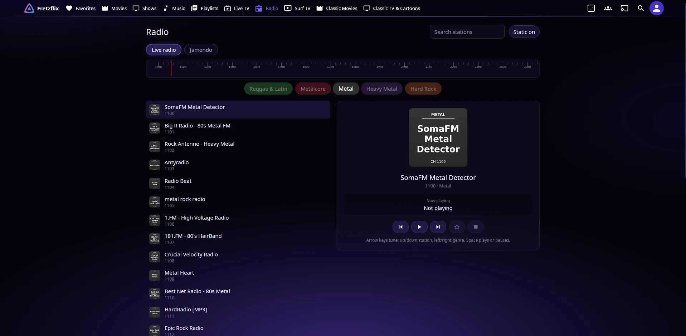

# Tuner (Jellyfin plugin)

Adds **Radio** and **Surf TV** pages to the Jellyfin web UI, plus a few home page touches: "Recently Added" rows that rotate, seasonal tiles in My Media, and library tiles that get a new picture every few days.

> Built with Claude for my own server and shared as is. It works on my setup (Jellyfin 12.4, the web UI, Jellyfin Media Player and the Android app). Updated as needed. Issues and pull requests are welcome.



## What it adds

- **Radio > Live radio:** internet radio stations from a station list you provide, on a tuning dial grouped by genre. Arrow keys or swipes tune, song titles from the stream show as they change, plus favorites, search, a "static" sound between stations (can be turned off), a mini player while you browse elsewhere, and lock screen / media key controls.
- **Radio > Jamendo:** Creative Commons music from Jamendo, one track after another per genre, with skip and **Keep**. Keep saves the MP3 into your music library, only when the artist allows downloads.
- **Surf TV:** flip through channels like cable. Free streaming channels from **Dispatcharr**, and over-the-air channels from an **HDHomeRun** tuner. Up/down changes channel, type a number to jump, L goes back to the last channel, F is full screen.
- **Home page:** the Recently Added rows load a longer list and slide to the next set of posters every couple of minutes, and Recently Added in Music shows at most three albums per artist.
- **My Media:** a seasonal tile (a collection that only shows up between two dates each year, Halloween by default), and library tiles that get a fresh background picture every few days.

Each part stays hidden until you set it up, and a switch turns off the pages without uninstalling.

**Web-based apps only:** the browser, Jellyfin Media Player, and the official Android and iPhone apps, which wrap the web UI. The native TV apps (Android TV, Roku, Apple TV) draw their own screens and won't show any of this.

## Install

Needs Jellyfin 12.2 or newer.

**From the plugin catalog (gets update notices):**

1. Dashboard > Plugins > **Repositories** (Catalog > the gear icon on some versions) > add:
   - Name: `Tuner`
   - URL: `https://raw.githubusercontent.com/coltonfretz/jellyfin-tuner/main/manifest.json`
2. Dashboard > Plugins > **Catalog** > Tuner > Install.
3. Restart Jellyfin.

**By hand:** download `tuner_<version>.zip` from [Releases](https://github.com/coltonfretz/jellyfin-tuner/releases), put `Jellyfin.Plugin.Tuner.dll` in a folder named `Tuner_<version>` inside Jellyfin's plugins folder (`/config/plugins` in the official Docker image), and restart Jellyfin.

Then open **Dashboard > Plugins > Tuner** to set it up, and reload the web UI.

## Settings

| Setting | What it does |
|---|---|
| Station list URL | Your radio stations, as an M3U file (format below). Empty: no live radio. |
| Jamendo client ID | A free client ID from [devportal.jamendo.com](https://devportal.jamendo.com). Empty hides Jamendo. Only the public client ID is needed, never the secret. |
| Keep folder | Where Keep saves Jamendo tracks: a folder inside an existing Music library, writable by Jellyfin (for example `/media/Music/Jamendo`). Empty turns Keep off. |
| Dispatcharr URL and API key | Surf TV's free channels and their guide. The key stays on the server; browsers never get it. |
| HDHomeRun address | Surf TV's antenna channels, for example `http://192.168.1.50`. Give the tuner a fixed address. |
| Antenna channels to hide / rename | Hide channels by number (`7.3,23.3`), and give channels friendlier names than their call signs (`7.1=PBS;12.1=NBC`). |
| Rotate Recently Added | On/off, and how often (20 s minimum). Also "spread music artists out". |
| Seasons | `Name=MM-DD..MM-DD` pairs separated by semicolons, both days included, wrapping past New Year if needed (`Holidays=12-01..01-05`). Name is a Jellyfin collection. |
| Hide the Collections library | Keeps the all-year Collections tile out of everyone's My Media, so seasonal collections only show in season. |
| Library tile pictures | Days between new pictures for each library's tile, 0 for never. Set it to 0 if you uploaded your own library pictures, or they'll be replaced. |
| Turn off the pages | Stops adding Tuner to the web UI without uninstalling. |

### Station list

An M3U file at an address the Jellyfin server can reach. Each station is an `#EXTINF` line followed by its stream address:

```
#EXTM3U
#EXTINF:-1 tvg-chno="1100" tvg-logo="http://example.com/logos/soma-metal.png" x-genre-color="#8E24AA",Metal · SomaFM Metal Detector
https://ice1.somafm.com/metal-128-mp3
```

- The name is **`Genre · Station`**: everything before the ` · ` is the genre the station is grouped under.
- `tvg-chno` (required; stations without it are skipped): the station's number on the dial. Keep the numbers stable, since favorites remember them.
- `tvg-logo` (optional): a picture for the station.
- `x-genre-color` (optional): the genre's color as `#RRGGBB`, on any station in that genre. Genres without one are gray.

[radio-browser.info](https://www.radio-browser.info) is a good source of stations and has a free API to build a list from.

## Seasonal tiles

While a season is on, a tile for its collection appears at the front of everyone's My Media. It looks and works like a library tile, and opens Jellyfin's own collection page. Out of season the tile is gone.

- Curate with Jellyfin's own **Add to collection**. The collection's Thumb image is the tile; Primary is the poster on its page.
- Playlists inside a season's collection are public in season and private (owner only) out of season, so a holiday mix isn't sitting in everyone's Playlists in June.
- The daily task **Dashboard > Scheduled Tasks > Tuner > Seasons and library tiles** (04:10 and at startup) handles the playlists, the Collections tile and the library pictures. Run it by hand after changing a season's dates.

## Top bar

Radio and Surf TV sit in the top bar right after Live TV. Jellyfin decides from the window size whether the bar shows text links or icons, without knowing about the extra two, so Tuner measures what fits and, in order:

1. Shows everything as text.
2. Moves the libraries after Live TV into **More**, one at a time.
3. Turns Radio and Surf TV into icons next to Search, as on narrow screens.
4. Moves Jellyfin's own links into More from the end, and finally shrinks the logo to its icon.

On a crowded phone bar the icons hide; Radio and Surf TV are always in the side menu. It re-checks on resize.

## How it works

```
jellyfin-web  --(script added to index.html)-->  tuner.js + tuner.css   (pages, dial, player)
     |
     |  the signed-in user's own session
     v
/Tuner/radio, /Tuner/tv, /Tuner/jamendo/*      [needs sign-in]
/Tuner/radio/{n}/stream, .../logo?t=<ticket>   ticket-signed (audio and img tags can't send headers)
     |
     +--> your station list, the stations themselves (relayed)
     +--> Dispatcharr, HDHomeRun, api.jamendo.com
```

Design choices, and why:

- **The script is added to the web page as Jellyfin serves it, not by editing files on disk.** Jellyfin 12 has no hook for this, the web folder is read-only in the Docker image, and a web update wipes on-disk edits. If anything goes wrong, the original page is served untouched.
- **Radio streams are relayed by the server.** An https page can't play plain http radio, and browsers can't read the song titles in the stream. The relay only plays addresses from your own station list, so it isn't an open proxy.
- **Tickets instead of tokens in URLs.** Audio and image tags can't send a sign-in header, and Jellyfin 12 dropped `?api_key=` on most endpoints. Tuner signs a 12-hour ticket with a key that changes on every restart.
- **Surf TV plays free channels straight from their servers** (much faster than opening them through Live TV), with a relay only for the few servers that refuse a web page.
- **Antenna channels are converted on the server** (HDHomeRun sends MPEG-TS that browsers can't play) and shared by everyone watching the same channel. It costs about one CPU core per channel with software encoding, and stops shortly after the last viewer leaves.
- **Jamendo's own radio channels aren't used:** they all redirect to unrelated streams. The track catalog works. Its API sometimes returns nothing, so each genre's tracks are cached for 12 hours, and a failed refresh keeps the old ones.

## Build

```bash
./build.sh
```

Builds `dist/Jellyfin.Plugin.Tuner.dll` in the official .NET 10 SDK container, so Docker is all you need. `BUILD_HOST=user@host ./build.sh` builds on another machine over SSH.

For a new version, bump `<AssemblyVersion>` in the `.csproj`. The script URL in the web page carries the version, so browsers only fetch the new script after a bump. `./release.sh "what changed"` builds it, makes the GitHub Release, and adds it to `manifest.json`.

### Trying a script change on a live server without installing it

In a new browser tab at `/web/manifest.json` (same address, no Jellyfin app running in it): fetch `/web/index.html` and the live `/Tuner/client.js` and `/Tuner/client.css`, apply your change as text replacements, point the script and link tags at `blob:` URLs of the changed files, run `history.replaceState(null, '', '/web/#/home')`, then `document.write` the page. It runs with that browser's own sign-in. Don't add a `<base>` tag. Close the tab after testing Surf TV, since it tunes a channel when it opens.

## License

MIT. See [LICENSE](LICENSE). hls.js (used for Surf TV) is Apache 2.0: `Jellyfin.Plugin.Tuner/Web/hls.LICENSE`.
