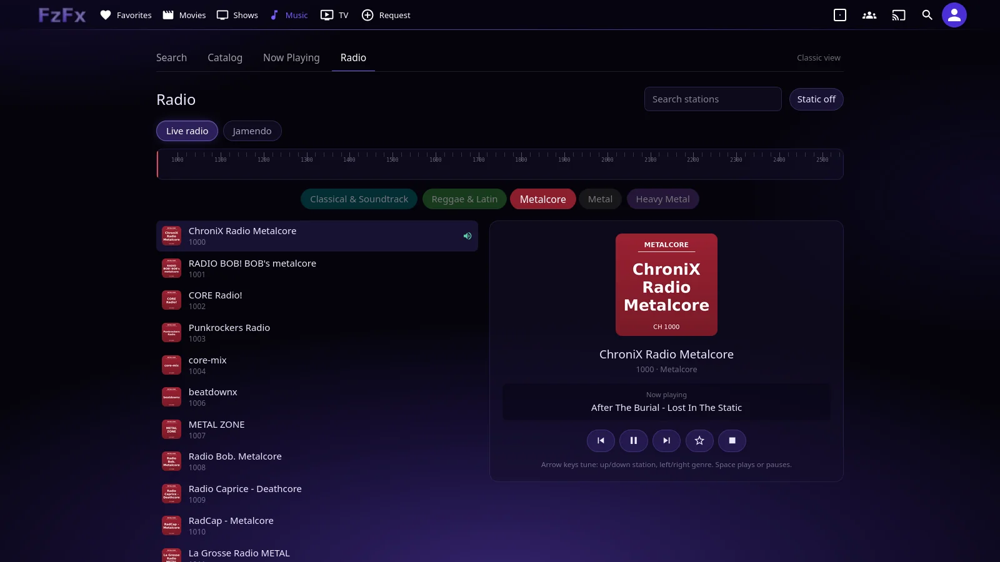

# Jellyfin-Tuned (Jellyfin plugin)

Radio and live TV pages for the Jellyfin web UI, plus a simpler Music page, tidier TV and Movies sections, a Request link and a few home page touches. Called Tuner before 1.0; the code and URLs still use that name.

> Built with Claude for my own server and shared as is. Tested on Jellyfin 12.4 (web UI, Jellyfin Media Player, Android app). Issues and pull requests are welcome.



## Contents

- [What it adds](#what-it-adds)
- [Install](#install)
- [Settings](#settings)
- [Station list format](#station-list-format)
- [Details](#details)
- [How it works](#how-it-works)
- [Build and release](#build-and-release)

## What it adds

Every part is off until you set it up.

**Pages**

- **Radio:** your own internet radio stations on a tuning dial, grouped by genre. Favorites, search, song titles, a mini player and media keys.
- **Jamendo:** Creative Commons music by genre, with **Keep** to save a track to your library (when the artist allows it).
- **Surf TV:** flip channels like cable. Free channels from Dispatcharr and antenna channels from an HDHomeRun.
- **Music (optional):** Search, Catalog, Now Playing (with lyrics) and Radio tabs. Jellyfin's own music page stays under **Classic view**.

**Sections**

- **TV:** one link with **Surf**, **Guide** and **Classics** tabs (Classics is a TV library you pick).
- **Movies:** **Library** and **Classics** tabs for a second movie library.
- **Request:** a link to your Seerr or Jellyseerr site. Opens inside Jellyfin when both share a site (`requests.example.com` and `example.com`, https), otherwise in a new tab. Searches that find nothing offer **Can't find it? Request it**.

**Home and everywhere**

- Recently Added rows rotate to the next posters every couple of minutes.
- Seasonal tiles in My Media (a collection that shows only between two dates).
- Library tiles get a new picture every few days.
- The player's controls stay up while the mouse rests on them.

**Works in** web-based apps: browsers, Jellyfin Media Player, and the official Android and iPhone apps. Native TV apps (Android TV, Roku, Apple TV) draw their own screens and won't show it.

## Install

Needs Jellyfin 12.2 or newer.

**From the catalog (gets update notices)**

1. Dashboard -> Plugins -> **Repositories** -> add `https://raw.githubusercontent.com/coltonfretz/jellyfin-tuner/main/manifest.json` (name it `Jellyfin-Tuned`).
2. Dashboard -> Plugins -> **Catalog** -> Jellyfin-Tuned -> Install.
3. Restart Jellyfin.

**By hand:** unzip `Jellyfin.Plugin.Tuner.dll` from [Releases](https://github.com/coltonfretz/jellyfin-tuner/releases) into `<plugins>/Jellyfin-Tuned_<version>/` (`/config/plugins` in the Docker image) and restart.

Then set it up in Dashboard -> Plugins -> Jellyfin-Tuned and reload the web UI.

## Settings

Three tabs. **Turn off the pages** (below them) hides everything without uninstalling.

**Radio & TV**

| Setting | What it does |
|---|---|
| Station list URL | Your stations as an M3U file ([format](#station-list-format)). Empty: no radio. |
| Jamendo client ID | Free from [devportal.jamendo.com](https://devportal.jamendo.com). Client ID only, never the secret. Empty: no Jamendo. |
| Keep folder | A writable folder inside a Music library, e.g. `/media/Music/Jamendo`. Empty: no Keep. |
| Dispatcharr URL + API key | Surf TV's free channels and guide. The key never reaches browsers. |
| HDHomeRun address | Surf TV's antenna channels, e.g. `http://192.168.1.50`. |
| Antenna hide / rename | Hide by number (`7.3,23.3`); rename (`7.1=PBS;12.1=NBC`). |

**Layout**

| Setting | What it does |
|---|---|
| Music page | On/off, plus the fewest songs that count as an album (default 4). |
| TV section | On/off, plus the TV library for the Classics tab. |
| Movies section | On/off, plus the movie library for the Classics tab. |
| Request site address | Your Seerr or Jellyseerr address. Empty: no Request link. |

**Home**

| Setting | What it does |
|---|---|
| Rotate Recently Added | On/off and how often (20 s minimum); optionally spread music artists out. |
| Seasons | `Name=MM-DD..MM-DD;...`, both days included (`Holidays=12-01..01-05`). Name is a collection. |
| Hide the Collections library | Keeps the all-year Collections tile out of My Media. |
| Library tile pictures | Days between new pictures; 0 = never (use 0 if you uploaded your own). |

## Station list format

An M3U file the server can reach:

```
#EXTM3U
#EXTINF:-1 tvg-chno="1100" tvg-logo="http://example.com/logos/soma-metal.png" x-genre-color="#8E24AA",Metal · SomaFM Metal Detector
https://ice1.somafm.com/metal-128-mp3
```

- **Name** is `Genre · Station`; the part before ` · ` is the genre.
- **`tvg-chno`** (required): the dial number. Keep it stable; favorites use it.
- **`tvg-logo`** (optional): the station's picture.
- **`x-genre-color`** (optional): the genre's `#RRGGBB` color, on any one of its stations.

[radio-browser.info](https://www.radio-browser.info) has a free API to build a list from.

## Details

**Music page**

- Genres come from the songs' own tags. Genres under 8 albums share a **More genres** tile.
- Decades with under 16 albums fold into one "Before ..." row.
- Daily picks (Spotlight, shelf order) are the same for everyone and change each day. Nothing is stored.
- Plays through Jellyfin's own player, so the queue, casting and lock screen work. No play history is used.

**Seasonal tiles**

- In season, the collection's tile leads My Media (its Thumb image is the tile). Out of season it's gone.
- Playlists in a season's collection are public in season and private out of it.
- The task Dashboard -> Scheduled Tasks -> Jellyfin-Tuned -> **Seasons and library tiles** runs daily at 04:10. Run it by hand after changing dates.

**Top bar and side menu**

- Tuner measures what fits. In order, it moves libraries into **More**, switches its own links to icons, then tucks Jellyfin's links and shrinks the logo.
- On a crowded phone bar its icons hide one at a time, Request last.
- The side menu always has every entry in Libraries: TV after Music, Request at the end.

**For other clients:** `GET /Tuner/sections` (signed in) returns the Classics library names, so a TV app can match them.

## How it works

```
jellyfin-web --(script added to index.html)--> tuner.js + tuner.css
     |  signed-in session
     v
/Tuner/radio, /Tuner/tv, /Tuner/jamendo/*, /Tuner/sections   [sign-in]
/Tuner/radio/{n}/stream, .../logo?t=<ticket>                  [ticket]
     +--> station list and streams (relayed), Dispatcharr, HDHomeRun, Jamendo
```

- **Script injected as the page is served,** not edited on disk (read-only in Docker, wiped by updates). On any error the original page is served.
- **Radio is relayed by the server** so https pages can play http streams and read song titles. Only your own stations, so it's not an open proxy.
- **Tickets, not tokens, in URLs:** audio and image tags can't send headers. 12-hour tickets, signed with a key that changes each restart.
- **Free channels play straight from their source** (faster than Live TV), relayed only when a source refuses web pages.
- **Antenna channels are converted on the server** (MPEG-TS) and shared by everyone on the same channel. About one CPU core each; stops after the last viewer.
- **Music plays through the browser's own session** ("play these", like casting from a phone), since jellyfin-web doesn't expose its player.

## Build and release

```bash
./build.sh
```

Builds `dist/Jellyfin.Plugin.Tuner.dll` in the .NET 10 SDK container (Docker only). `BUILD_HOST=user@host ./build.sh` builds over SSH.

To release: bump `<AssemblyVersion>` in the `.csproj` (browsers only fetch the new script after a bump), then `./release.sh "what changed"`.

**Testing a script change without installing:** in a tab at `/web/manifest.json`, fetch `/web/index.html`, `/Tuner/client.js` and `/Tuner/client.css`, apply your edits, point the tags at `blob:` URLs, `history.replaceState(null, '', '/web/#/home')`, then `document.write` the page. No `<base>` tag. Close it after Surf TV (it tunes a channel).

## License

MIT, see [LICENSE](LICENSE). hls.js (Surf TV) is Apache 2.0: `Jellyfin.Plugin.Tuner/Web/hls.LICENSE`.
